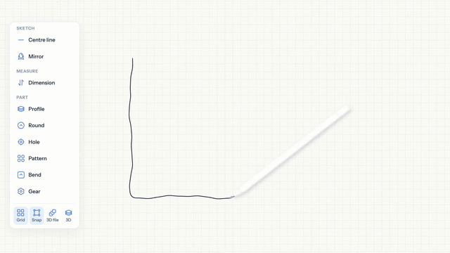

# MRUHacks 2026

Working repo for our MRU Hacks 2026 project.

[](https://youtu.be/SnpjP7i6cqc)

## Current direction

**Sketch to 3D part, with a CAD-style view.**

- Engineers draw a 2D profile on an iPad (Safari web canvas, no app install).
- The laptop server sends the sketch to an AI model, which returns a fixed set of operations (profile, extrude, hole, cut).
- Code (CadQuery, open source) builds the solid part from those operations.
- The laptop, which is also the projected display, shows the result in a CAD-style browser window (three.js, grid, dimensions, orbit view).
- Edits are made by drawing on the iPad (for example, a circle becomes a hole).

Demo parts, in priority order: mounting bracket, flanged pipe, spur gear (stretch).

## Laptop screen (FreeCAD)

The `freecad/` folder is a FreeCAD workbench, BoardSketch, that shows the part live while it is drawn.
It follows the bridge's live feed (`/api/stream`): on each `model` event from the CadQuery builder it downloads
the STEP from `/api/model` and swaps it into the 3D view, with a build-up animation when the part changes shape.
A pulsing border runs round the 3D view while a drawing change is being turned into a model.

- Install once, with FreeCAD closed: `sh freecad/install.sh`. It links the workbench into FreeCAD and sets
  FreeCAD's preferences for a light, fast screen (no anti-aliasing, navigation cube, autosave or splash).
  Run it again if FreeCAD ever opens with its toolbars or panels missing: it clears the saved layout so
  FreeCAD starts with its own defaults.
- Run, with the server up: `sh freecad/start.sh`. Every FreeCAD workbench stays available; Focus in the
  BoardSketch toolbar hides or shows FreeCAD's own toolbars and panels. `sh freecad/start.sh lite` loads
  only the modules BoardSketch needs, for a slow machine.

## Open items

- Confirm the judging criteria and theme wording on the MRU Hacks 2026 page.
- Confirm CadQuery license and install on every demo machine.
- Run the model gate: 4 of 5 hand sketches must produce valid operation JSON.
- Time a manual CAD baseline for the impact number. Don't use an estimate on stage.

## Running it

1. Once: `pip3 install -r requirements.txt`, `npm install`, and `sh freecad/install.sh` (with FreeCAD closed).
2. Build the iPad canvas after every pull: `npm run build`.
3. Start the server: `python3 server.py`. It serves the canvas at `http://<laptop address>:8000` (`ipconfig getifaddr en0`).
4. Start the laptop screen: `sh freecad/start.sh`.

## Live 3D model (laptop backend)

`model.py` turns the canvas's part description (`partSketch()`, in mm) into a CadQuery solid while the user draws. No AI call is needed for this: extrudes, revolves, through/blind/counterbore/countersink holes, drawn cut-outs, hole patterns and bolt circles all come straight from the drawing. Until a profile is marked, closed outlines show as a 10 mm preview plate.

Every snapshot from the iPad goes to a background builder. It builds the newest one, skips any that went stale while it was busy, and reuses unchanged features. For the frontend:

| What | Where |
|---|---|
| Live updates | `GET /api/stream`, event `model` (sent first on connect, then after every rebuild) |
| Latest model info | `GET /api/model/info` (add `?session=<id>` for one session) |
| Model files | `GET /api/model?format=brep` (or `stl`, `3mf`, `step`, `glb`). Add `&download=1` to save it as `part-<session>-<seq>.<format>`. The `files` URLs in each event already carry the session and a version |
| Print | `POST /api/print` opens the part (3MF) in the laptop's slicer: Bambu Studio, OrcaSlicer, PrusaSlicer or Cura |

A `model` event looks like:

```json
{"session": "k3f9a2", "seq": 42, "status": "ok", "preview": false, "features": 1,
 "volume": 146272.6, "bbox": {"min": [0, -80, -60], "max": [15, 40, 60]}, "buildMs": 27, "warnings": [],
 "sketch": [{"points": [[0, 0], [50, 0]], "closed": false, "role": "sketch"}],
 "files": {"brep": "/api/model?session=k3f9a2&format=brep&v=42", "stl": "...", "3mf": "...", "step": "...", "glb": "..."}}
```

- `status`: `ok`; `empty` (nothing closed on the iPad: **remove the part**, so the view matches the canvas); or `error` (see `warnings`: keep the last good part).
- `preview`: true while nothing is marked as a part yet.
- `bodies`: one entry per part, in the order of the solids in the model file (a compound when there are several):
  `{id, material, process, volume, mass, seeThrough, finish: {metallic, roughness}}`. Every extrude or revolve is a part
  of its own; one drawn on another part is layered on its top or set into it ("New part" in the Profile dialog).
  Where parts overlap, the smaller is cut out of the bigger, which is `seeThrough` so the part inside shows.
  `mass` is the sum of the parts' masses, each in its own material; FreeCAD and the GLB use `finish` so metals shine.
- `sketch`: the drawing's loose lines and shapes in mm, not yet part of the solid. Draw them on the sketch plane (z = 0). `role` is `sketch`, `hole` or `centre line`.
- Only the BREP is written on every rebuild (2 ms, and the fastest for FreeCAD to load). The other formats are made when first asked for.
- Units are mm. The sketch is the XY plane seen from +Z, and extrudes rise along +Z. The GLB is already turned Y-up for three.js; the other formats stay Z-up.

Each build (`sessions/<id>/b000N/`) also gets its own `model.step`, `.stl` and `.glb`.

## Files

- `BoardSketch_Build_Spec.pdf`: earlier concept (labeled circuit checker), kept for comparison.
